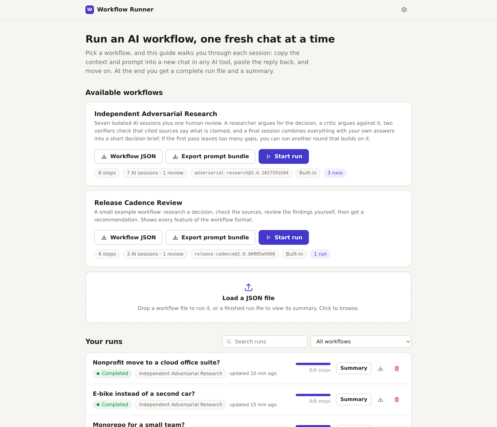

# Workflow Runner

Run multi-step AI workflows where every step is a fresh, isolated session.

Each step sees only the earlier outputs it's meant to see. That isolation is the point: a critic that
never saw the researcher's reasoning, or a verifier that only checks sources, gives more honest answers
than one long chat. You can do each step by hand in any chat app, or let Claude, Codex or a local model
run it for you. When you finish you have a run file with every output and your answers, and a summary page.

It's built for one person on their own computer: no accounts, and runs are plain JSON files on disk.



## Quick start

With Docker:

```bash
git clone https://github.com/alexbakertech/workflow-runner.git
cd workflow-runner
docker compose up -d --build
```

With Node.js 24:

```bash
git clone https://github.com/alexbakertech/workflow-runner.git
cd workflow-runner
npm install
npm run dev
```

Open http://localhost:3000. On first start, choose **Load sample runs** to see finished examples. The
[quickstart](docs/quickstart.md) walks through installing and a first run, step by step.

## Features

- **Isolated sessions.** Each step is a separate AI session that gets only the files you choose to feed it.
- **By hand or by agent.** Copy and paste into any chat app, or let Claude, Codex or local models (through
  pi) run steps, one at a time or chained automatically.
- **A built-in adversarial research workflow.** A researcher, a critic, source verifiers, your own review
  and a conditional decision brief.
- **Your own workflows.** Write them in JSON, with [schemas](docs/schemas/) and an
  [example](docs/examples/example-workflow.json).
- **Verdicts that act.** A source check that says "Revise" can stop the run or have the agent fix the flagged claims.
- **Rounds and follow-ups.** Run another round, or a short follow-up on open questions, inside the same run.
- **Run files with integrity hashes.** One JSON file per run, with SHA-256 hashes that show whether it
  was edited outside the app.
- **Prompt bundles and sample runs.** Export any workflow as plain Markdown prompts, and load finished
  example runs to see how it ends.

## Prompt bundles (no install)

Every built-in workflow is also available as plain Markdown prompts, so you can follow it with only a chat
app and no Workflow Runner at all. See [bundles/README.md](bundles/README.md).

## Documentation

| Page | What's in it |
|---|---|
| [Quickstart](docs/quickstart.md) | Install, a first run by hand, and signing in an agent. |
| [User guide](docs/user-guide.md) | The built-in workflow, running steps with an agent, loading files, behaviour notes. |
| [Configuration](docs/configuration.md) | Environment variables, Settings, Docker, the data folder, npm scripts. |
| [Troubleshooting](docs/troubleshooting.md) | Fixes for common problems. |
| [Workflow format](docs/workflow-format.md) | Every field of a workflow file, and how to write prompts the app can parse. |
| [Run format](docs/run-format.md) | Every field of a run file, and how to verify its hashes. |
| [HTTP API](docs/api.md) | Scripting the app. |
| [Architecture](docs/architecture.md) | Code map and how a step runs. |
| [Security](SECURITY.md) | What agents can do, access token, your data. |
| [Contributing](CONTRIBUTING.md) | Setup, checks before a pull request. |

## Requirements

Node.js 24, or Docker. For agents, optionally a Claude or Codex sign-in or API key, or pi with local
models. Without any of them, everything still works by hand.

## License

MIT. See [LICENSE](LICENSE).
