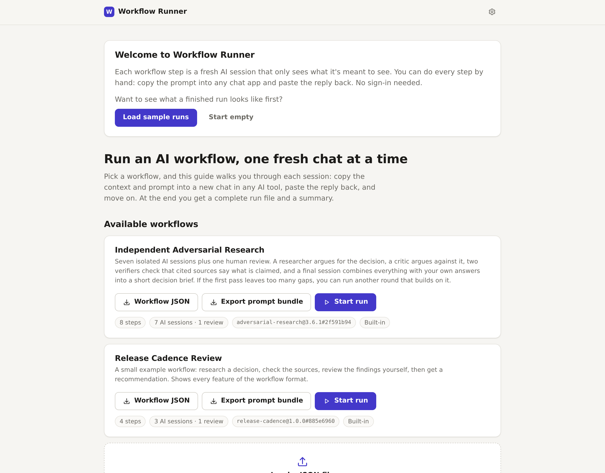
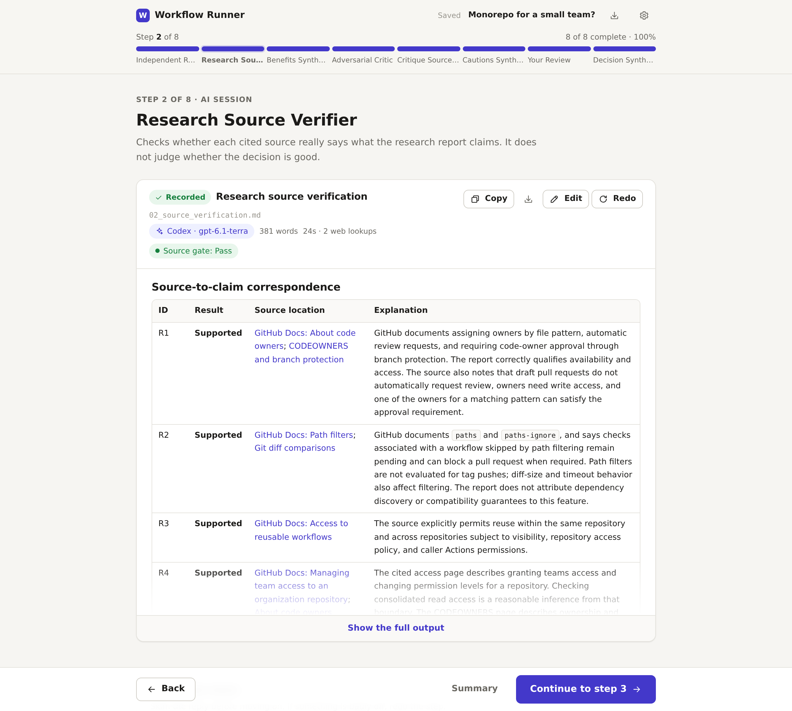
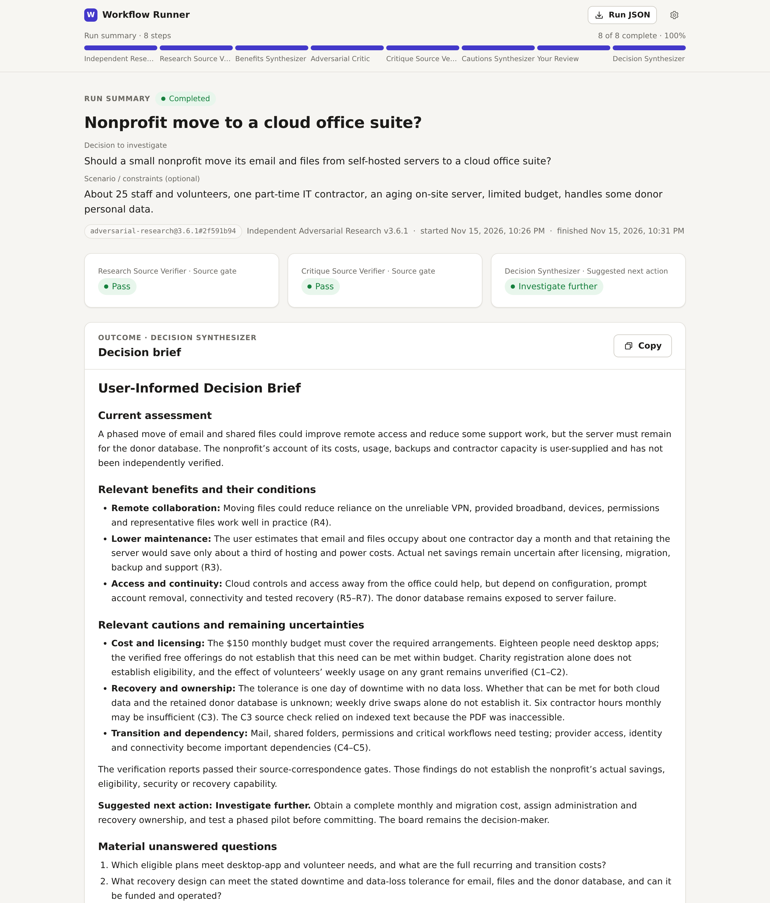

# Quickstart

This guide takes you from nothing to a finished first run. You don't need to be good with a terminal:
you only need to open one and paste a few commands.

## What you'll have at the end

Workflow Runner running on your computer at http://localhost:3000, and one finished run of the built-in
**Independent Adversarial Research** workflow. The run is a single JSON file you can keep, plus a
summary page. You'll do it by hand first, with any chat app. Letting an agent do the steps is optional
and comes later.

## Pick a way to run it

| | Docker | Node.js |
|---|---|---|
| Install | Docker Desktop | Node.js 24 |
| Start | `docker compose up -d --build` | `npm install`, then `npm run dev` |
| Restarts on its own | Yes, whenever Docker starts | No, you start it each time |
| Agent tools (Claude, Codex, pi) | Already in the image | You install them yourself, only if you want agents |
| Best for | Leaving it running in the background | Trying it quickly, or working on the code |

If you already have Docker Desktop, use Docker. Otherwise use Node.js. Run only one of them at a time,
because both use port 3000. They share the same `data/` folder, so your runs are the same either way.

You'll type commands in a terminal: **Terminal** on macOS and Linux, **PowerShell** on Windows.

## With Docker

1. Install Docker Desktop from [docs.docker.com/get-docker](https://docs.docker.com/get-docker/) and
   start it. Wait until it says it's running.
2. Get the code. Either clone it (needs [git](https://git-scm.com/downloads)):

   ```bash
   git clone https://github.com/alexbakertech/workflow-runner.git
   ```

   or download the ZIP from [the repository page](https://github.com/alexbakertech/workflow-runner) (**Code → Download ZIP**) and unzip it.
3. Open a terminal in the project folder. For a clone, that is the folder it created:

   ```bash
   cd workflow-runner
   ```

   Use the folder name of your own copy if it's different (a ZIP download may be called
   `workflow-runner-main`).
4. Build and start it:

   ```bash
   docker compose up -d --build
   ```

   The first build takes several minutes. Later starts are quick.
5. Open http://localhost:3000.

The container restarts automatically with Docker. To manage it, run these in the same folder:

```bash
docker compose logs -f          # follow the log (Ctrl+C to stop following)
docker compose down             # stop it
docker compose up -d            # start it again
docker compose up -d --build    # update: after pulling new code (git pull) or unzipping a newer version
```

Docker only listens on this computer (`127.0.0.1:3000`), so the access token check is off. Your runs
are saved in the `data/` folder next to `docker-compose.yml`.

## With Node.js

1. Install Node.js 24 from [nodejs.org](https://nodejs.org/). If you use nvm, run `nvm install` and
   then `nvm use` in the project folder. The `.nvmrc` file picks version 24 for you.
2. Get the code, the same way as for Docker (`git clone https://github.com/alexbakertech/workflow-runner.git`, or download the ZIP and
   unzip it). Open a terminal in that folder.
3. Install and start:

   ```bash
   npm install
   npm run dev
   ```
4. Open http://localhost:3000. Keep the terminal open: closing it stops the app. Press Ctrl+C to stop it
   yourself.

For a faster, production-style server, use this instead of `npm run dev`:

```bash
npm run build
npm start
```

`npm start` turns on the access token, because the app could then be reached from other devices. The
token is saved in `data/access-token.txt` and printed in the log on first start. You can also see it in
**Settings → Access token**. Your browser asks for it once and then stays signed in for a year. To
turn the check off, set `ACCESS_TOKEN=off`. See [configuration.md](configuration.md).

## Your first run, by hand



You don't need any sign-in for this. You'll use a chat app you already have, such as ChatGPT, Claude
or Gemini.

1. On the home page, a **Welcome to Workflow Runner** panel appears the first time, when you have no
   runs. Press **Load sample runs** to import a finished example. Press **Start empty** to skip it.
   Either way the panel goes away.
2. If you loaded the samples, open the example under **Your runs** with its **Summary** button. This is
   what the end of a run looks like. Then go back to the home page with **All runs**.
3. Under **Available workflows**, find **Independent Adversarial Research** and press **Start run**.
4. Fill in the setup page:
   - **Decision to investigate** (required): a decision you are considering, for example "Is replacing
     a gas furnace with a heat pump worthwhile for a typical household?"
   - **Scenario / constraints (optional)**: facts the AI should assume, such as your climate or budget.
   - **Run title**: filled in for you; change it if you like.

   Press **Start step 1**.
5. Each AI step has the same four tasks. If you see an **Agent / By hand** toggle, choose
   **By hand**. Without a signed-in agent you only see the by-hand steps.
   1. Open a brand-new chat in your chat app.
   2. Press **Copy context** and paste it into the chat. Don't send yet. Step 1 has no context, so
      skip this one there.
   3. Press **Copy prompt** and paste it below the context. Send it and wait for the full reply.
   4. Copy the reply with the chat's own copy button and paste it into the box in Workflow Runner.
      If the AI made a `.md` file, you can use **Upload .md** instead.

   Then press **Save & continue to step 2**, and so on. The button is greyed out until a reply is in.
   The run saves on its own, so you can leave and come back from **Your runs**.

   **The one rule: use a fresh chat for every step.** Each step is meant to see only what you paste
   in. A chat that remembers earlier steps defeats the point.
6. Step 7 is **Your Review**. It's a form and needs no AI. Read the two summaries, answer their
   questions in your own words, add any context, and choose under **What would you like to do?**. For
   now choose **Proceed to Step 07**. The other choices are to run another round, pause, or
   stop.
7. The last AI step is the **Decision Synthesizer**. Do it the same way as the others. It produces a
   short, conditional decision brief that uses everything you gathered, including your answers.
8. Press **Finish & see summary**. The summary page shows the brief and every earlier output. Press
   **Download run JSON** to save the whole run as one file.





## Optional: let an agent do the steps

An agent does a step for you as a fresh session on the same machine. Open **Settings** (the gear icon
at the top right of every page). Under **Agents** you see Claude, Codex and Local. Each card shows
**Ready**, **Not signed in** (Claude, Codex), **Not set up** (Local) or **Not available**. If one isn't ready, the card shows what's wrong
and the exact command to fix it, with a **Copy** button. Press **Check again** after you run it.

### Claude

Sign in with your Claude subscription:

```bash
claude auth login
```

With Docker, Settings shows this command instead, which runs it inside the container:

```bash
docker exec -it workflow-runner claude auth login
```

Or use an API key: set `ANTHROPIC_API_KEY` (see "Docker and `.env`" below).

### Codex

On the host (Node.js):

```bash
codex login
```

With Docker, Codex has its own sign-in inside the container. Run this and open the link it prints:

```bash
docker exec -it workflow-runner codex login --device-auth
```

Or set `OPENAI_API_KEY`. If the `codex` command isn't found when you run the app with Node.js, Settings
suggests `npm i -g @openai/codex`.

### Local models (pi)

The **Local** agent runs models on your own machine or network through
pi. It only offers the providers you list in pi's
`models.json` (normally in `~/.pi/agent`). There's no sign-in. If Settings says no local providers were
found, add your model server to that file. With Node.js, install pi first if Settings asks for it:
`npm i -g @earendil-works/pi-coding-agent`. Set `PI_CODING_AGENT_DIR` if your pi folder is somewhere
else.

### Docker and `.env`

For API keys, copy `.env.example` to `.env` next to `docker-compose.yml`, uncomment the line you need,
and add your key:

```bash
cp .env.example .env
```

On Windows PowerShell, use `copy .env.example .env`. Then recreate the container so it picks up the
change:

```bash
docker compose up -d
```

If you already use Claude Code or pi on this computer, you can share them with the container instead
of signing in again. Create the folders first, so Docker doesn't create them owned by root, then copy
the example override file:

```bash
mkdir -p ~/.claude ~/.pi/agent
cp docker-compose.override.example.yml docker-compose.override.yml
docker compose up -d
```

(PowerShell: `mkdir $HOME\.claude, $HOME\.pi\agent` and `copy docker-compose.override.example.yml
docker-compose.override.yml`.) Codex is never shared this way. It always signs in inside the container.

### Using an agent on a step

Once a provider shows **Ready**, each open AI step has an **Agent / By hand** toggle. On **Agent**:

1. Choose a provider (and a model, if offered).
2. Press **Run step N with** the provider's name. You can leave the page; the step keeps running and
   the reply is saved to the run.
3. Read the reply, then go on with **Save & continue to step N**.

Tick **Keep going automatically** to have the agent also run the following AI steps. You can make it
the default in **Settings**. It always stops at your review step and at warnings, such as a "Block"
verdict, a reply that looks cut off, or any failure. You can also click a step in the route shown
under the checkbox to make the agent stop before it. You can switch any step back to **By hand** at any
time, and the two ways mix freely in one run.

## Where your data lives

Everything is in the `data/` folder inside the project, for both Docker and Node.js:

| Path | What |
|---|---|
| `data/runs/` | One JSON file per run, saved as you go. |
| `data/templates/` | Workflows you've loaded. |
| `data/access-token.txt` | The access token, once it's created. |
| `data/jobs/` | Logs of agent jobs. |

Runs are plain JSON, so any backup works. Copy the `data/` folder somewhere safe, or just copy
`data/runs/`. To back up one run, press **Download run JSON** on its summary page. To restore, put the
folder back, or drop a downloaded run file on the home page. Don't copy the folder while an agent is
running a step.

## Next steps

- [Workflow format](workflow-format.md): write your own workflow.
- [Run format](run-format.md): what's inside a run file.
- [Configuration](configuration.md): ports, the access token, data location and other settings.
- [Troubleshooting](troubleshooting.md): when something doesn't work.
- [Prompt bundles](../bundles/README.md): every built-in workflow as plain Markdown prompts, so you can
  follow it with only a chat app and no Workflow Runner at all. **Export prompt bundle** on a workflow
  card downloads the same thing for any workflow you've loaded.
