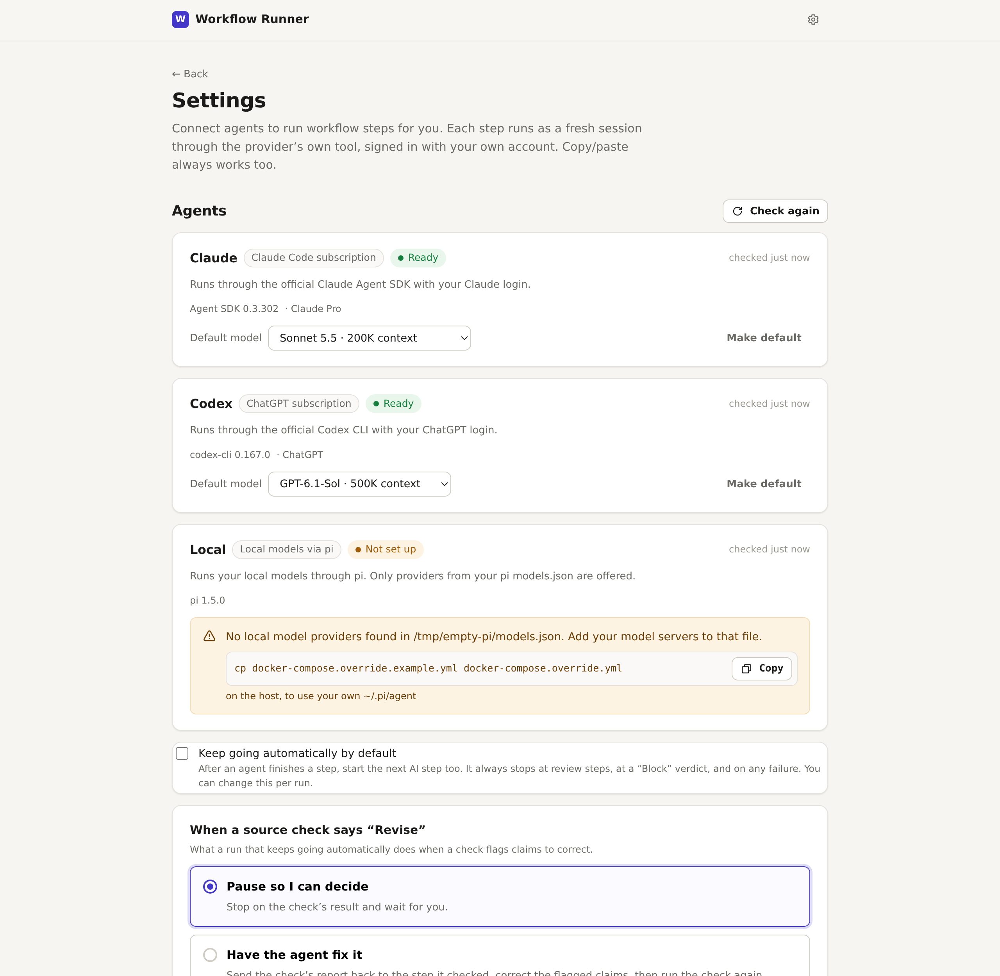

# User guide

How to use Workflow Runner once it's running. To install it and finish a first run, start with the
[quickstart](quickstart.md). Settings, environment variables and Docker details are in
[configuration.md](configuration.md), and fixes for common problems are in
[troubleshooting.md](troubleshooting.md).

## Contents

1. [The built-in workflow](#the-built-in-workflow)
2. [Running steps with an agent](#running-steps-with-an-agent)
3. [What you can load](#what-you-can-load)
4. [Workflow and run files](#workflow-and-run-files)
5. [Behaviour notes](#behaviour-notes)
6. [Sample runs](#sample-runs)
7. [Prompt bundles](#prompt-bundles)

## The built-in workflow

**Independent Adversarial Research** (`templates/adversarial-research-v3.json`) helps you make a
decision. Seven AI sessions and one review:

| Step | What it does |
|---|---|
| 01 Researcher | Argues for the decision: up to five benefits, as numbered claims with sources. |
| 02 Source verifier | Checks the cited sources really say what 01 claims. Gives a verdict (Pass / Revise / Block). |
| 03 Benefits summary | Condenses 01 and 02, with up to three questions for you. |
| 04 Critic | Argues against: costs, risks, failure conditions, alternatives. |
| 05 Source verifier | Checks the critic's sources the same way. |
| 06 Cautions summary | Condenses 04 and 05, with up to three more questions. |
| Your review | You answer the questions and choose: continue, pause, stop, or run another round. |
| 07 Decision brief | Combines everything with your answers into a short, conditional recommendation. |

If a verifier says Revise, the agent can correct the flagged claims. If the brief says to
investigate further, you can do a quick follow-up or a whole new round, kept in the same run.

The `templates/` folder also holds a smaller example, Release Cadence Review.

## Running steps with an agent



Each AI step has a **Run with…** panel. It sends the step's context and prompt to an agent, which
runs as a fresh, isolated session. The reply lands in the step for you to review. Copy/paste still
works everywhere. For installing and signing in to each agent, see the
[quickstart](quickstart.md#optional-let-an-agent-do-the-steps). Without any agent, everything still
works by hand.

| Agent | How it runs | Sign-in |
|---|---|---|
| **Claude** | Official Claude Agent SDK (bundled Claude Code binary) | Run `claude auth login`, or set `ANTHROPIC_API_KEY`. In Docker the sign-in is kept in the `claude-home` volume: run `docker exec -it workflow-runner claude auth login`. To use the host's `~/.claude` instead, use the [override file](configuration.md#override-file-host-sign-ins). |
| **Codex** | Official Codex CLI (`codex exec`) | Its own login inside the container: `docker exec -it workflow-runner codex login --device-auth`, then open the link it prints. Stored in the `codex-home` volume. Without Docker, run `codex login`. |
| **Local** | pi, with only the providers in your pi `models.json` | No sign-in. In Docker, `models.json` lives in the `pi-agent` volume unless you use the [override file](configuration.md#override-file-host-sign-ins), which shares the host's `~/.pi/agent` (and with it your model servers and extensions such as pi-exa). |

`npm run dev` uses the CLIs installed on the host (`claude` login, `codex`, `pi`).

- **Isolated sessions.** Each step runs in a fresh session in an empty working folder. What an agent
  can do differs by provider: Claude gets web search and fetch only, and loads none of the host's
  settings, hooks, plugins or MCP servers. Codex runs in a read-only sandbox and can read files.
  pi keeps the extension tools you installed. See
  [What agents can do](../SECURITY.md#what-agents-can-do) for the details.
- **Input files.** Earlier outputs are sent inline between `--- BEGIN FILE ---` markers, and the agent
  is told to reply with the requested file's content. Stray filename headings or code fences around
  that content are removed.
- **One step at a time.** Only one step runs across the whole app; others wait in a queue. Steps run on
  the server, so you can close the tab. Job logs are in `data/jobs/`.
- **Agent or by hand.** Each open AI step has an **Agent / By hand** toggle, so only one way of doing
  the step is on screen. The choice is remembered.
- **Recorded outputs are locked.** Finished steps, and replies an agent has just delivered, show as a
  read-only record (rendered Markdown, who wrote it, word count, signals). Changing one is deliberate:
  **Edit** opens a separate editor that saves nothing until you press Save, and **Redo** runs the step
  again. Either one warns which later steps were built on it, and those are flagged as out of date
  afterwards. Edits are recorded (`steps[].editedAt`).
- **Stops.** With "Keep going automatically" on, the route of upcoming steps is shown; click one to make
  the agent stop before it so you can do or check it yourself (`agentBreakpoints` in the run file).
- **Keep going automatically.** Runs the following AI steps too. It stops at review steps, at warning
  signals such as "Gate result: Block", when a reply looks cut off, and on any failure. For "Revise",
  [Settings](configuration.md#agents) chooses whether it pauses, has the agent correct the flagged
  claims once, or carries the flag forward. It never retries on its own, and usage-limit or
  extra-usage errors stop the chain.
- **Context gauge.** Shows roughly how much of the chosen model's context window the step's input
  uses. Local models with a small output limit (`maxTokens` in pi's `models.json`) get a warning,
  because long reports can be cut off.
- **What's recorded.** Each agent-written step stores the provider, model, session id, duration and
  number of web lookups in the run file (`steps[].agent`).
- **Codex's own sign-in.** Codex keeps SQLite databases in `~/.codex`, and opening those from the
  container while the host's Codex app has them open risks corrupting them. That's why it isn't shared.

## What you can load

Drop either of these on the home page. The app works out which kind it is.

| File | What happens |
|---|---|
| Workflow template (`"format": "workflow-template"`) | Added to the workflow list, ready to run |
| Run file (`"format": "workflow-run"`) | Imported, its hashes are checked, and its summary opens |

Workflows you upload are saved to `data/templates/`. Runs autosave to `data/runs/*.json`. See
[the data folder](configuration.md#the-data-folder).

## Workflow and run files

Full documentation is in [`docs/`](README.md):

- [Workflow format](workflow-format.md): every field, prompts and placeholders, verdict signals,
  review forms, rounds, follow-up research, and how to write prompts the app can parse.
- [Run format](run-format.md): every field of a run file, rounds and follow-ups, file naming,
  jq recipes, and how to verify the hashes.
- [HTTP API](api.md) for scripting.
- JSON Schemas for both formats, plus an example workflow, an example run and a Python parser.

In short: to start a new workflow, click **Workflow JSON** on any workflow card (or start from
[`examples/example-workflow.json`](examples/example-workflow.json)), edit it, bump `version`, and
drop it back in. Changing anything gives the workflow a new hash, so it shows up as a separate entry
with its own tag. Uploaded workflows can be removed with the trash icon on their card. Runs started from
them keep working, because each run file includes its own copy of the workflow.

Every run is one file (`data/runs/<id>.json`, or **Download run JSON**). It embeds the workflow, every
output, earlier rounds and follow-ups. It also carries two SHA-256 hashes, so you can tell which
workflow produced it and whether it was edited outside the app.

## Behaviour notes

- If you change an earlier reply after later steps are done, those later steps show a warning
  ("an earlier step changed"), because the context they were given no longer matches.
- **Edit prompt** changes the prompt for the current run only. The run records the edited text.
- At the review step, **Pause** saves the run and sends you home, and **Stop** skips the remaining steps.
  You can reopen a stopped run from its summary page.
- **Run another round** at the review continues the same run from step 1, with this round's outputs as
  extra inputs. Earlier rounds stay viewable from the summary page.
- When the final recommendation says to investigate further, the summary offers a quick follow-up
  (one research session on the open questions, then the recommendation again), an update with your own
  answers, or a full new round. Follow-ups are limited per round; new rounds aren't.

## Sample runs

The samples are finished example runs, so you can see what a completed run and its summary look like.
On first start, with no runs yet, the home page offers **Load sample runs**. The same thing is
available from the command line:

```bash
npm run seed
```

Both skip samples that are already loaded or whose hashes don't verify, and say why. The files live in
[`samples/`](../samples/README.md).

## Prompt bundles

**Export prompt bundle** on a workflow card downloads the workflow as plain Markdown prompts, so you
can follow it in any chat app without Workflow Runner. The built-in workflows are already exported in
[`bundles/`](../bundles/README.md).
